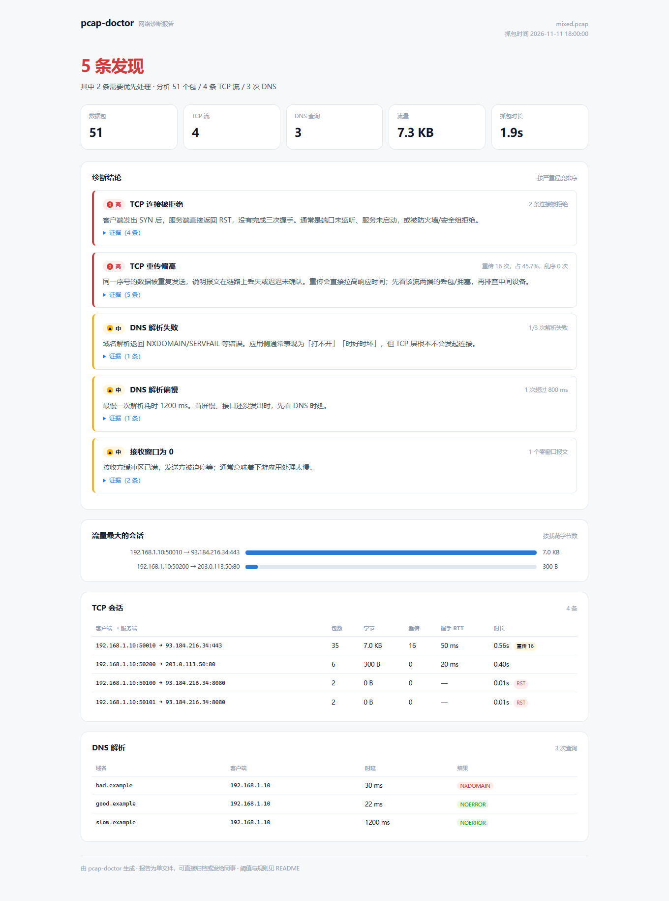

# pcap-doctor

[](https://github.com/natorshzhong-netizen/pcap-doctor/actions/workflows/ci.yml)

**丢一段 pcap，回答三个问题：谁慢、为什么慢、证据在哪。**

读包 → 还原 TCP 会话和 DNS 查询 → 计算重传/握手 RTT/零窗口/解析失败 → 按确定性规则归因 → 输出一份带包号和相对时间的单文件 HTML 报告。



## 它解决什么问题

线上「网站很慢」时，常见的排查方式是打开 Wireshark 按时间排序、肉眼找红色行。这个项目把这一步变成可复现的规则：

- **不猜**：重传率、握手 RTT、DNS 时延都有明确算法，报告里给出计算口径。
- **有证据**：每条结论附流信息、包序号和相对抓包起点的秒数，能直接回到 Wireshark 定位。
- **可回归**：仓库自带 5 个注入了已知故障的 pcap，规则改动后跑评测看有没有退化。

> 它做的是**网络层/传输层诊断**，不解密 TLS，也不做安全审计。

## 快速开始

```bash
python -m venv .venv

# Windows
.venv/Scripts/python.exe -m pip install -r requirements.txt
.venv/Scripts/python.exe -m src.pcap_doctor demo --open

# macOS / Linux
.venv/bin/python -m pip install -r requirements.txt
.venv/bin/python -m src.pcap_doctor demo --open
```

`demo` 会生成 5 个演示 pcap（干净、重传、连接拒绝、DNS 失败、混合故障），逐个分析并打开 `reports/mixed.html`。

Windows 也可以直接双击 `start.bat`。

## 分析自己的抓包

```bash
python -m src.pcap_doctor analyze capture.pcap --report reports/capture.html
python -m src.pcap_doctor analyze capture.pcap --json reports/capture.json --fail-on-high
```

- `--fail-on-high`：有高危发现时退出码为 1，方便放进巡检脚本。
- 报告是单文件，截图、样式全部内联，可以直接发给同事。

### 实时抓包（可选）

```bash
python -m src.pcap_doctor capture --seconds 20 --iface "Wi-Fi" --out capture.pcap
```

需要先安装 **Npcap**（Wireshark 安装包里勾选 Npcap），并以管理员身份运行。没装驱动也能用离线 pcap 和 demo——这一点是刻意设计的。

## 检测规则

| code | 触发条件 | 默认严重度 |
|---|---|---|
| `tcp_connection_refused` | SYN 后服务端直接 RST，未完成握手 | 高 |
| `tcp_retransmission` | 重传 ≥ 3 次且占该流包数 ≥ 1% | 中；≥ 10 次或 ≥ 5% 为高 |
| `tcp_zero_window` | 出现接收窗口为 0 的报文 | 中 |
| `tcp_duplicate_ack` | 连续重复 ACK ≥ 5 个 | 中 |
| `tcp_reset` | 连接建立后被 RST 中断 | 中 |
| `tcp_slow_handshake` | SYN → SYN-ACK ≥ 300 ms | 低 |
| `dns_failure` | NXDOMAIN / SERVFAIL 等 | 中；SERVFAIL 或失败占比 ≥ 50% 为高 |
| `dns_unanswered` | 抓包窗口内只有查询、没有响应 | 中 |
| `dns_slow` | 单次解析 ≥ 800 ms | 中 |
| `top_talker` | 单端点发送 ≥ 85% 且总量 ≥ 20 KB | 提示 |

阈值集中在 `src/pcap_doctor/detect.py` 顶部，改完跑 `eval/run_eval.py` 就能看到影响。

## 评测

```bash
python eval/run_eval.py
```

| 指标 | 结果 |
|---|---|
| 场景完全命中 | 5 / 5 |
| precision | 100% |
| recall | 100% |
| 测试 | 8 passed |

> 这是仓库自带的 5 个合成场景，不是公开数据集；数字用于证明规则改动没有退化，不代表对任意真实流量的准确率。

## 架构

```text
capture.pcap
    │
    ▼  ① load.py：scapy 解析成 PacketView（与 scapy 解耦，便于单测）
    │
    ├── ② flows.py：五元组归并、握手 RTT、重传/乱序/重复 ACK/零窗口
    └── ③ dns.py：query/response 配对、时延、rcode
                 │
                 ▼  ④ detect.py：确定性规则 → Finding（严重度 + 证据）
                 │
                 ▼  ⑤ report.py：单文件 HTML（结论在前，证据在后）
```

## 关键设计决策

### 1. 重传按「方向 + 序号 + 载荷长度」判重，不按时间

只看「同一个包又出现了一次」会把合法的重发、Keep-Alive 和乱序误判成丢包。这里以 `(方向, seq, payload_len)` 作为身份，第二次出现才计重传；同时单独统计乱序，避免两个指标互相污染。

### 2. 握手 RTT 和应用时延分开

`SYN → SYN-ACK` 只反映网络往返和服务端 accept 队列；应用慢、数据库慢不会体现在这里。报告把两者分开，就是为了避免「握手 30 ms，所以应用没问题」的错误结论。

### 3. 同一根因聚合

一次抓包里可能有 10 条连接被拒绝。如果输出 10 条 finding，读者只会看到噪音；所以按规则聚合为一条，metric 写「N 条连接被拒绝」，证据里列前几条流。重传、零窗口同理按流聚合。

### 4. 证据必须可回查

每条 finding 都带包序号和相对时间（例如 `包 #23（+0.140s）`），而不是只给一句「有重传」。报告里的流表同时给出两端地址、包数、字节、重传数、握手 RTT，方便回到 Wireshark 复核。

### 5. 离线优先，实时抓包是加分项

评测和 demo 全部基于合成 pcap，不依赖网卡、驱动和权限；`capture` 只是薄薄一层 scapy `sniff`，缺 Npcap 时给出明确提示，而不是抛堆栈。

## 目录

```text
pcap-doctor/
├── demo/                 # 生成的演示 pcap（可重新生成）
├── docs/report.png       # 报告截图
├── src/pcap_doctor/
│   ├── load.py           # pcap → PacketView
│   ├── flows.py          # TCP 会话与指标
│   ├── dns.py            # DNS 配对
│   ├── detect.py         # 规则与阈值
│   ├── report.py         # 单文件 HTML
│   ├── demo.py           # 合成故障 pcap
│   └── cli.py            # demo / analyze / capture
├── eval/                 # 5 个场景的检测评测
├── tests/                # 8 个测试
└── .github/workflows/ci.yml
```

## 局限

- 不做 TLS 解密，应用层内容（HTTP 路径、SQL、业务错误码）看不到。
- 只覆盖 TCP/UDP/DNS 的传输层指标，不做 HTTP/2、QUIC、WebSocket 协议还原。
- 合成样本覆盖的是常见故障形态；真实网络里的中间设备、NAT、分片会影响指标，需要结合现场判断。
- 实时抓包依赖 Npcap 和管理员权限，本项目默认走离线路径。

## License

MIT © 2026 钟诚
